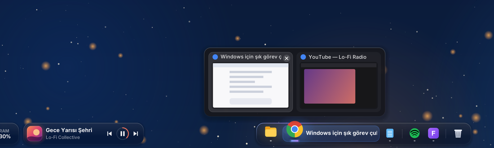
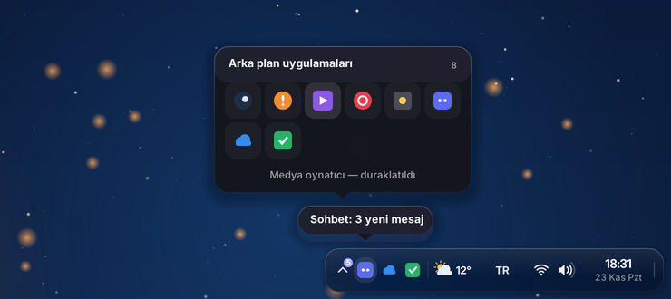

<p align="center"></p>
<h1 align="center">NovaBar</h1>
<p align="center">Windows 10/11 için hafif, animasyonlu, premium görev çubuğu ve dock.<br>
Tek dosya · ~540 KB · kurulum yok · Direct2D + DirectComposition</p>

<p align="center"></p>
<p align="center"></p>
<p align="center"></p>

> Görseller tasarım önizlemesidir; gerçek görünüm duvar kâğıdına ve uygulamalarına göre değişir.

## Özellikler

- **Ada tasarımı** — Başlat + sistem bilgisi, müzik çalar, dock ve saat ayrı yüzen adalarda. Adalar duvar kâğıdının bulanık, canlı renkli hâliyle dolar (buzlu cam), ince grain dokusu, parlak kenar ve yumuşak gölgeyle.
- **macOS tarzı dock** — İmlecin altındaki ikon büyüyüp adanın üstüne taşar, komşuları yer açar. Her uygulama kendi renginde parlar; aktif uygulama başlığını gösterir, altındaki gradyan çizgi yaylanarak kayar.
- **Müzik çalar** — Spotify, YouTube, Apple Music vb. (Windows medya kontrollerini kullanan her şey): albüm kapağı, şarkı/sanatçı, önceki/oynat/sonraki, ilerleme halkası.
- **Canlı pencere önizlemeleri** — İkonun üzerinde bekle: açık pencerelerin canlı küçük görüntüleri; tıkla geç, × ile kapat.
- **Kontrol Merkezi** — Ses adasına tıkla: sürüklenebilir ses kaydırıcısı, anlık ağ hızı, karanlık mod anahtarı, odak zamanlayıcısı, ekran alıntısı / pano / emoji kısayolları, Wi-Fi, Bluetooth, Ayarlar ve kilitle · uyku · yeniden başlat · kapat (yeniden başlat ve kapat ikinci tıklamada onay ister).
- **Bugün paneli** — Saate tıkla: büyük saat, hava durumu ve 6 saatlik tahmin, gezinilebilir aylık takvim.
- **Sistem tepsisi** — Arka plandaki uygulamaların (sohbet, bulut, antivirüs…) küçük simgeleri sağ adada; ilk birkaçı doğrudan görünür, ok düğmesi hepsini ızgara hâlinde açar. Sol tık, sağ tık menüsü, çift tık ve ipucu metinleri uygulamaya iletilir; orta tık simgeyi gizler. Windows'un ses, ağ ve pil simgeleri NovaBar'da zaten olduğu için gösterilmez. Windows'un kendi tepsisi de güncel kalır.
- **Hava durumu** — Sağ adada sıcaklık ve durum ikonu ([open-meteo.com](https://open-meteo.com), anahtar gerektirmez). Şehir: `WeatherCity` ayarı.
- **Odak zamanlayıcısı** — Sol adada geri sayan halka; tıkla duraklat, sağ tıkla iptal.
- **Duvar kâğıdından renk** — Vurgu renkleri duvar kâğıdına göre kendiliğinden seçilir.
- Dakika değişince kayan saat rakamları; açılır paneller açıldıkları yeri gösteren bir uçla gelir.
- **Geri Dönüşüm Kutusu**, **sürükle-bırak ile sıralama ve sabitleme**, **klavye dili göstergesi (TR/EN)**.
- CPU/RAM halkaları, ağ · ses · pil, tekerlekle ses ayarı, saat/tarih, masaüstünü göster.
- Tam ekran oyun/videoda kendini gizler. Boştayken kare çizmez, CPU'yu neredeyse hiç kullanmaz.

## Kurulum

1. **[NovaBar.exe'yi indir](https://github.com/kiralikceset/novabar/raw/main/bin/NovaBar.exe)** ve kalıcı bir klasöre koy (ör. `C:\Araclar\NovaBar`).
2. Çalıştır. İmzasız olduğu için SmartScreen uyarısı çıkabilir: **Ek bilgi → Yine de çalıştır**.
3. Bara sağ tıkla → **Windows ile başlat**.
   NovaBar, oturum açılır açılmaz (bekleme olmadan) çalışan bir Görev Zamanlayıcı görevi kurar; çökerse 1 dakika içinde kendini yeniden başlatır.
   NovaBar.exe'yi önce kalıcı klasörüne taşı, sonra bu seçeneği aç. Açılışta çalışmazsa exe'nin yanındaki `NovaBar.log` dosyası ne olduğunu yazar; ayrıca *Ayarlar → Uygulamalar → Başlangıç* listesinde NovaBar'ın açık olduğuna bak.

Ayarlar exe'nin yanındaki `NovaBar.ini` dosyasında (sağ tık → *Ayar dosyasını aç*): konum, yükseklik, kenar boşluğu, ada/tek parça görünüm, vurgu renkleri (`AutoAccent=0` ile elle), hava durumu şehri (`WeatherCity`), odak süresi (`FocusMinutes`) ve tüm özelliklerin aç/kapa anahtarları.

> Hava durumu için NovaBar, ayarladığın şehrin adını open-meteo.com'a gönderir. İstemezsen sağ tık → *Hava durumu* ile kapat.

**Geri alma:** Sağ tık → *NovaBar'dan çık* Windows görev çubuğunu geri getirir. Çökme olursa: `NovaBar.exe --restore` veya Görev Yöneticisi → Windows Gezgini → Yeniden başlat.

## Derleme

- Windows: [MSYS2](https://www.msys2.org/) MinGW64 kabuğunda `build.bat`
- Linux: `sudo apt install mingw-w64` ve `./build.sh`

## Microsoft Store paketi

`store/` klasörü Store için gerekenleri içerir: paket bildirimi (`AppxManifest.template.xml`), logolar, ekran görüntüleri, mağaza metinleri (`LISTING.md`) ve paketleyici. Partner Center'daki *Ürün kimliği* değerlerini `store/identity.ini` dosyasına yazıp şunu çalıştır:

```
./build.sh && python3 store/make_msix.py      # dist/NovaBar.msix (imzasız; Store imzalar)
```

Store sürümü ayarlarını uygulamanın kendi klasöründe (`%LOCALAPPDATA%\Packages\…\LocalState`) tutar ve Windows ile başlatmak için paketin başlangıç görevini kullanır. Gizlilik politikası: [PRIVACY.md](PRIVACY.md).

## Kendini toparlama

- **Bekçi süreci:** `NovaBar.exe` önce küçük bir bekçi olarak açılır ve asıl barı `NovaBar.exe --child` olarak başlatır. Bu yüzden Görev Yöneticisi'nde iki NovaBar görürsün. Bar çökerse ya da ~25 sn donarsa bekçi önce Windows görev çubuğunu geri getirir, sonra barı yeniden açar. Bar 3 dakikada 5 kez çökerse bekçi pes eder ve ekranda Windows görev çubuğu kalır.
- **Tam ekran algılama:** Windows'un "tam ekran uygulama" bildirimi yerine bar ön plandaki pencereyi kendisi kontrol eder. Tam ekran bir pencere varken gizlenir, o pencere kapanınca geri gelir.
- **Gözetim:** Bar 2 saniyede bir yerinde ve görünür olup olmadığını kontrol eder. Uykudan uyanınca grafik ve konum baştan kurulur.
- **Günlük:** Ne olduysa `NovaBar.log` dosyasına yazılır (`CRASH`, `self-heal`, `guardian` satırları).
- Bekçi olmadan çalıştırmak için: `NovaBar.exe --noguard`

## Bilinen sınırlar

- Yalnızca ana monitör.
- Sistem tepsisi, uygulamaların tepsi mesajlarını NovaBar'a yönlendirerek çalışır; bir uygulamada sorun görürsen sağ tık → *Sistem tepsisi simgeleri* ile kapatabilirsin (Windows tepsisi etkilenmez).

## Lisans

[MIT](LICENSE)
